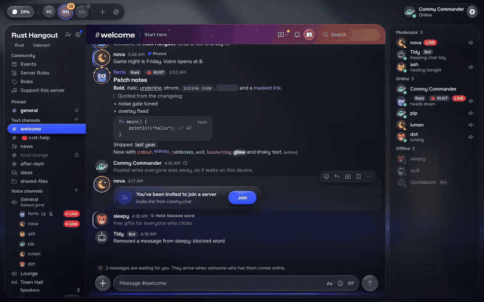
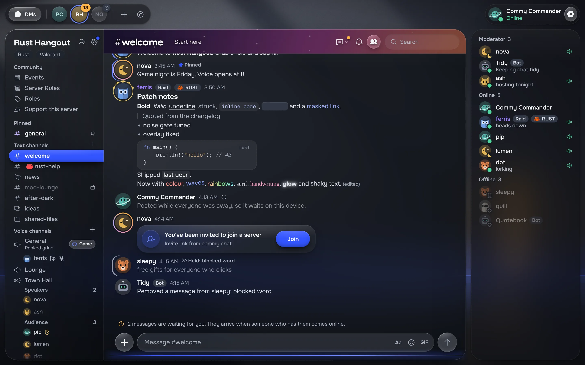
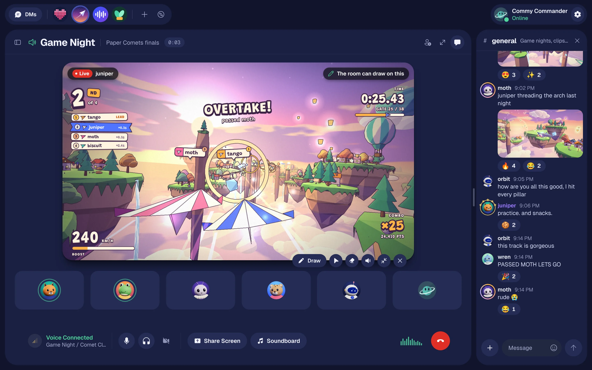
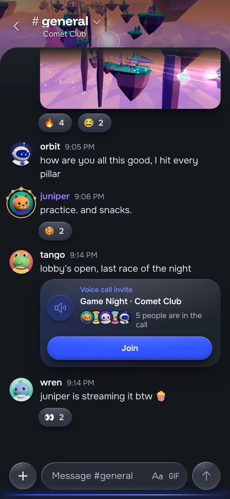
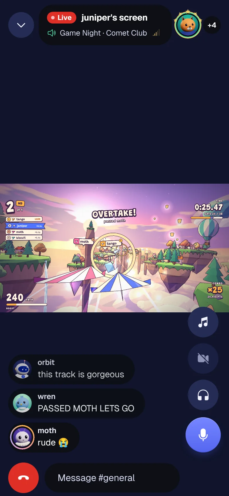
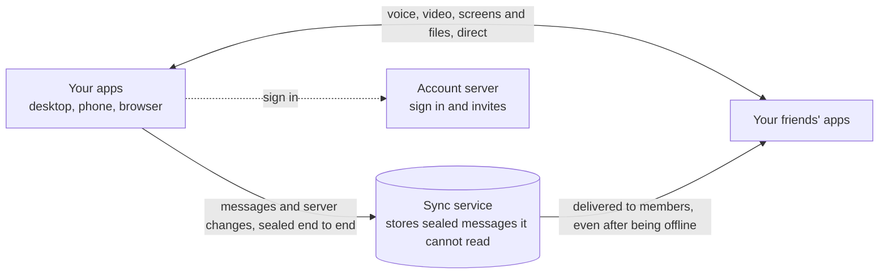

<a id="readme-top"></a>

<div align="center">

<a href="https://commy.chat">
  
</a>

<h1>Commy</h1>

<p>
  <strong>Free, open source voice, video and text chat for your community.</strong><br />
  Text channels, drop-in voice and game streaming in one app for desktop, phone and web, with nothing locked behind a paywall.
</p>

[![Download][download-shield]][download-url]
[![License: AGPL-3.0][license-shield]][license-url]
[![Built with Rust][rust-shield]][rust-url]
[![As seen on Open Source Alternatives][osa-shield]][osa-url]

<p>
  <a href="https://commy.chat"><strong>commy.chat</strong></a>
  &middot;
  <a href="https://commy.chat/download">Download</a>
  &middot;
  <a href="https://commy.chat/web">Open in your browser</a>
  &middot;
  <a href="https://commy.chat/docs">Guides</a>
  &middot;
  <a href="https://github.com/commy-commander/commy/issues/new?template=bug_report.yml">Report a bug</a>
</p>

<a href="https://commy.chat">
  
</a>

<p>
  <sub>If Commy looks like a good home for your community, a star helps more people find it.</sub>
</p>

</div>

<details>
  <summary>Table of contents</summary>
  <ol>
    <li><a href="#why-commy">Why Commy</a></li>
    <li><a href="#a-closer-look">A closer look</a></li>
    <li><a href="#quickstart">Quickstart</a></li>
    <li><a href="#how-it-works">How it works</a></li>
    <li><a href="#learn-more">Learn more</a></li>
    <li><a href="#contributing">Contributing</a></li>
    <li><a href="#support-commy">Support Commy</a></li>
    <li><a href="#license">License</a></li>
    <li><a href="#contact">Contact</a></li>
    <li><a href="#acknowledgments">Acknowledgments</a></li>
  </ol>
</details>

## Why Commy

Your community needs one place to talk, hang out and play together, and it
should not cost a subscription to get the good stuff. Commy is that place:
free to use, open source from top to bottom, and yours to host if you want.

- **Chat that feels alive.** Replies, reactions, threads, forums, polls,
  custom emoji, stickers, voice messages and rich text with code blocks,
  colours and effects.
- **Voice that just works.** One click noise cancellation, a volume for each
  person, a soundboard, voice filters and stage channels for big moments.
- **Stream your game.** Share a whole screen or a single window, with sound
  on Windows, and let the room draw on it together.
- **Tools for moderators.** Roles and permissions, auto moderation, timeouts,
  bans, onboarding questions and an audit log.
- **Private by design.** Messages sync sealed end to end, and voice, video,
  screen shares and files go straight between members.
- **Everywhere you are.** Windows, macOS, Linux, iPhone, iPad, Android and the
  browser, all from one codebase.
- **Yours to host.** Run your own sync and account servers and keep your
  community's history on hardware you control.

[See everything Commy can do](docs/features.md)

<p align="right">(<a href="#readme-top">back to top</a>)</p>

## A closer look

<table>
  <tr>
    <td width="50%"></td>
    <td width="50%"></td>
  </tr>
  <tr>
    <td align="center"><strong>Rich text chat</strong><br /><sub>Markdown, code, colours, invites and moderation in one feed</sub></td>
    <td align="center"><strong>Voice rooms and streams</strong><br /><sub>Drop in, watch a friend play, and keep chatting on the side</sub></td>
  </tr>
</table>

<p align="center">
  
  &nbsp;&nbsp;
  
  <br />
  <sub>The same servers on iPhone and Android, with streams you can watch on the go.</sub>
</p>

<p align="right">(<a href="#readme-top">back to top</a>)</p>

## Quickstart

### Use Commy

| Platform | Get it |
| --- | --- |
| Windows, macOS, Linux | [Download](https://commy.chat/download) |
| iPhone and iPad | [App Store](https://apps.apple.com/app/commy-chat/id6831824908) |
| Android | [Google Play](https://play.google.com/store/apps/details?id=chat.commy.mobile) |
| Browser | [Web app](https://commy.chat/web) |

Make an account, then start a server or join one with an invite link.

### Try the interface in under a minute

The desktop interface runs in any browser with built-in demo data, so you can
click around without installing Rust or making an account. All you need is
Git and Python 3.

```sh
git clone https://git.commy.chat/commy/commy.git
cd commy/apps/desktop/ui
python3 -m http.server 5174
```

On Windows, run `python -m http.server 5174` for the last step. Open
[localhost:5174](http://localhost:5174) for the demo server, or
[localhost:5174/?streams](http://localhost:5174/?streams) to drop into a voice
channel where two members are streaming.

### Build the desktop app

You need Rust (stable), Node.js and the Tauri 2 CLI
(`cargo install tauri-cli --version "^2"`).

```sh
git clone https://git.commy.chat/commy/commy.git
cd commy/apps/desktop/src-tauri
cargo tauri dev
```

The [build guide](docs/building.md) covers setup on each platform, the web
client and the phone apps.

<p align="right">(<a href="#readme-top">back to top</a>)</p>

## How it works



Messages and server state always go through the sync service, sealed on your
device before they leave it, so they reach people who were offline. Calls,
screen shares and files go straight between members. Read more in
[How Commy works](docs/how-it-works.md).

### Built with

[![Rust][rust-shield]][rust-url]
[![Tauri][tauri-shield]][tauri-url]
[![WebAssembly][wasm-shield]][wasm-url]
[![Node.js][node-shield]][node-url]
[![PostgreSQL][postgres-shield]][postgres-url]

<p align="right">(<a href="#readme-top">back to top</a>)</p>

## Learn more

- [Everything Commy can do](docs/features.md)
- [How Commy works](docs/how-it-works.md)
- [Building Commy](docs/building.md)
- [Verifying a download](docs/verifying-downloads.md)
- [Hosting your own server](deploy/HOSTING.md)
- [Running bots](crates/commy-bot/README.md)
- [User guides on commy.chat](https://commy.chat/docs)

<p align="right">(<a href="#readme-top">back to top</a>)</p>

## Contributing

Ideas, fixes and translations are all welcome. New here? Issues labelled
[good first issue](https://github.com/commy-commander/commy/issues?q=is%3Aissue+is%3Aopen+label%3A%22good+first+issue%22)
are small and well scoped. Read [CONTRIBUTING.md](CONTRIBUTING.md) and the
[Code of Conduct](CODE_OF_CONDUCT.md), then open a pull request into `main`.
Found a problem? Open an
[issue](https://github.com/commy-commander/commy/issues/new/choose). For
security problems, follow [SECURITY.md](SECURITY.md) instead.

<p align="right">(<a href="#readme-top">back to top</a>)</p>

## Support Commy

Commy is free, and it stays that way thanks to people like you. Two ways to
help:

- **Star the repository.** It costs nothing and helps other communities find
  Commy.
- **Leave a tip.** If Commy is home for your community, you can help keep the
  lights on through [Ko-fi](https://ko-fi.com/commychat).

[![Support Commy on Ko-fi][kofi-shield]][kofi-url]

<p align="right">(<a href="#readme-top">back to top</a>)</p>

## License

Commy is licensed under the [GNU Affero General Public License v3.0](LICENSE).

## Contact

Commy Commander · [commy.chat](https://commy.chat) ·
[support@commy.chat](mailto:support@commy.chat)

Follow along on
[Bluesky](https://bsky.app/profile/commychat.bsky.social),
[Mastodon](https://mastodon.social/@commychat),
[X](https://x.com/commy_chat) and
[YouTube](https://www.youtube.com/@commychat).

## Acknowledgments

Commy stands on the shoulders of [Tauri](https://tauri.app),
[Opus](https://opus-codec.org), [nnnoiseless](https://github.com/jneem/nnnoiseless),
[Better Auth](https://www.better-auth.com) and
[Sigstore cosign](https://github.com/sigstore/cosign). README layout from
[Best-README-Template](https://github.com/othneildrew/Best-README-Template).

<p align="right">(<a href="#readme-top">back to top</a>)</p>

[download-shield]: https://img.shields.io/badge/download-commy.chat-3355ff.svg?style=for-the-badge
[download-url]: https://commy.chat/download
[kofi-shield]: https://img.shields.io/badge/Ko--fi-support%20Commy-FF5E5B.svg?style=for-the-badge&logo=ko-fi&logoColor=white
[kofi-url]: https://ko-fi.com/commychat
[license-shield]: https://img.shields.io/badge/license-AGPL--3.0-blue.svg?style=for-the-badge
[license-url]: LICENSE
[rust-shield]: https://img.shields.io/badge/Rust-000000?style=for-the-badge&logo=rust&logoColor=white
[rust-url]: https://www.rust-lang.org
[tauri-shield]: https://img.shields.io/badge/Tauri_2-24C8D8?style=for-the-badge&logo=tauri&logoColor=white
[tauri-url]: https://tauri.app
[wasm-shield]: https://img.shields.io/badge/WebAssembly-654FF0?style=for-the-badge&logo=webassembly&logoColor=white
[wasm-url]: https://webassembly.org
[node-shield]: https://img.shields.io/badge/Node.js-339933?style=for-the-badge&logo=nodedotjs&logoColor=white
[node-url]: https://nodejs.org
[postgres-shield]: https://img.shields.io/badge/PostgreSQL-4169E1?style=for-the-badge&logo=postgresql&logoColor=white
[postgres-url]: https://www.postgresql.org
[osa-shield]: https://www.opensourcealternatives.to/badge-osa.svg
[osa-url]: https://www.opensourcealternatives.to
